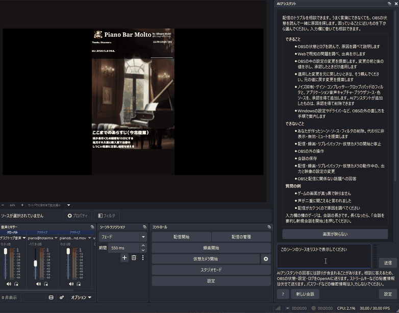

# AI Assistant for OBS Studio / OBS Studio 向け AI アシスタント

[English](#english) | [日本語](#日本語)



## English

Also listed on [Plugin Soko-kun](https://soko-kun.allegromoltov.jp/plugins/allegromoltov/ai-assistant-for-obs?lang=en).

An OBS Studio dock plugin where you can talk to an AI assistant about streaming problems. The assistant reads the OBS state and log, searches the web, and explains the cause. Problems that can be fixed inside OBS are fixed on the spot after you approve the change.

> This plugin is free. However, OpenAI API usage is billed separately to your own OpenAI account, and you need an OpenAI API key that you issue yourself. OpenAI API usage is made with your own account and at your own responsibility. See [Responsibility and no warranty](#responsibility-and-no-warranty).

### Background

When streamers run into problems in OBS Studio such as "nothing shows up", "no sound", or "the video stutters", they often cannot put the cause into words. This plugin is a partner that helps you reach the cause through a conversation, even if you cannot describe the problem well. The conversation screen and flow follow the screens and flows published by AI chat products for developers.

### Features

- Start a consultation just by picking one of seven common problems shown in an empty conversation: nothing shows up, no game or PC audio, no microphone audio, doubled audio or echo, stuttering video, dropped streams or frames, and microphone noise
- The assistant reads the OBS state and statistics, scenes and sources, source details, and the last 300 lines of the OBS log, and asks follow-up questions to narrow down the cause
- When it searches the web for known issues, the answer includes links to the sources
- Answers are displayed as they arrive
- The assistant proposes changes to OBS settings and adds the filters and sources listed below. Each proposal shows the values before and after the change, and is applied only when you approve it
- To revert a change, ask the assistant. It proposes a change back to the original values
- A help window lists what the assistant can and cannot do
- A gauge next to the input box shows the conversation length. From about 50%, a button to summarize the conversation and start a new one appears
- You can open and check what was sent to OpenAI in the conversation
- The dock is available in English and Japanese. The assistant answers in the OBS display language, or in the language you write in

| | |
| --- | --- |
| What it can do | Investigate and explain the cause, search the web, change settings inside OBS, add noise suppression, gain, compressor, and crop/pad filters and application audio capture, browser, and color sources, delete the filters and sources it added, guide you through fixes outside OBS |
| What it cannot do | Delete scenes or sources and filters you created, start or stop streaming, recording, the replay buffer, or the virtual camera, operate anything outside OBS, save conversations, answer topics unrelated to OBS and streaming |

The filters and sources added by the assistant are marked in their private settings, and can be deleted with your approval. When you ask it to delete something you created, it suggests hiding, disabling, or muting instead. Output and video settings are not changed while streaming, recording, the replay buffer, or the virtual camera is active.

### Requirements

- A Windows x64 PC and OBS Studio 33 or later
- An OpenAI API key. Issue one on [the OpenAI API keys page](https://platform.openai.com/api-keys). You also need to set up billing for API usage

### Cost

OpenAI API usage is billed to your OpenAI account. The author of the plugin receives no fees. The plugin uses `gpt-6.1-terra` (reasoning effort low) for conversations and web searches. Check the latest prices on [the OpenAI pricing page](https://developers.openai.com/api/docs/pricing). In the author's tests of the seven common problems, one consultation cost about 0.012 USD on average and about 0.055 USD at most. Most of the cost comes from web searches.

### Data sent and data not stored

- The plugin communicates only with `api.openai.com`, and only after you press Send
- To answer, your messages and the OBS state, settings, and log that the assistant reads are sent to OpenAI. The settings include scene and source names, text source contents, image and video file paths, and browser source URLs
- Images and video are not sent
- Before sending, your messages and the content read from OBS are checked with the OpenAI moderation API. Content that may violate the OpenAI usage policies is not sent
- Secrets such as stream keys, keys in stream URLs, query string values, passwords, and tokens are masked before sending
- Requests are sent with `store: false`
- Conversations are not saved to files. Conversation text and the API key are not written to the OBS log or the plugin log
- The API key is encrypted with Windows DPAPI and stored in `%APPDATA%\obs-studio\plugin_config\ai-assistant-for-obs\`

### Responsibility and no warranty

- This plugin calls the OpenAI API with an API key you issued yourself. OpenAI API usage is made with your own account, and complying with the OpenAI terms and usage policies is your responsibility
- If scene or source names, text source contents, or file names contain content that violates the OpenAI usage policies, that content is sent to OpenAI
- This plugin is provided under GPL-2.0 without warranty. The author is not liable for any damage caused by using it. Answers and proposals may contain mistakes. Check the values before and after a change before you approve it

### Platforms

| OS | Distribution | Verified |
| --- | --- | --- |
| Windows x64 | Prebuilt ZIP | Tested on OBS Studio 33.0.1 |
| macOS, Linux | Not distributed | Only the GitHub Actions builds are checked. The plugin cannot be used on macOS and Linux because saving the API key is supported only on Windows |

### Installation

1. Download the latest Windows x64 ZIP from [Releases](https://github.com/AllegroMoltoV/ai-assistant-for-obs/releases).
2. Quit OBS Studio and extract the ZIP.
3. Type `%PROGRAMDATA%` in the File Explorer address bar, then open `obs-studio` and `plugins`. Create the folders if they do not exist.
4. Copy the `ai-assistant-for-obs` folder from the ZIP into that `plugins` folder. If Windows asks for administrator permission, allow it.

### Usage

1. Start OBS Studio and show "AI Assistant" from the Docks menu.
2. Open "Settings" in the dock, enter your OpenAI API key, and press "Save". When "Status: saved" appears, you are ready.
3. Describe your problem in the input box and press "Send", or press one of the problems shown in an empty conversation. Enter sends, and Shift+Enter inserts a new line.
4. The assistant reads the OBS state and explains the cause and how to fix it.
5. Setting changes and filter and source additions and deletions are shown as proposals. Check the values before and after, then press "Approve and apply" or "Reject".
6. Press "New conversation" to start another consultation. The "?" button opens the help window.

Building from source is described in the Japanese section below.

## 日本語

[配信プラグイン倉庫くん](https://soko-kun.allegromoltov.jp/plugins/allegromoltov/ai-assistant-for-obs) にも掲載しています。

配信のトラブルを、OBS Studio のドックのチャットで相談できるプラグインです。AI アシスタントが OBS の状態とログを読み、Web を調べて原因を説明します。OBS の中で直せるものは、利用者の承認を得てその場で直します。

> このプラグインは無料です。ただし、OpenAI API の利用料金は、利用者ご自身の OpenAI アカウントに別途請求されます。利用には、ご自身で発行した OpenAI の API キーが必要です。OpenAI API の利用は、利用者ご自身のアカウントと責任で行います。詳しくは「[利用者の責任と無保証](#利用者の責任と無保証)」を参照してください。

### 背景

配信者は、OBS Studio で「映らない」「音が入らない」「カクつく」といったトラブルに出会っても、原因を自分で言葉にできないことが多くあります。このプラグインは、うまく言葉にできなくても、会話を通じて原因にたどり着けるようにするための相談相手です。会話の画面と操作の流れは、開発者向けの AI のチャットの製品で公開されている画面と操作の流れを手本にしています。

### 主な機能

- 空の会話に置いた候補から選ぶだけで相談を始められます。候補は次の 7 つです。
  - 画面が映らない
  - ゲームや PC の音が入らない
  - マイクの声が入らない
  - 音が二重になる・エコーがかかる
  - 映像がカクつく
  - 配信が切れる・フレームがドロップする
  - マイクのノイズが気になる
- AI アシスタントは、OBS の状態と統計、シーンとソース、ソースの詳細、OBS のログの末尾 300 行を読み、足りない点を聞き返しながら原因を絞り込みます
- 既知の問題を Web で調べたときは、回答に出典のリンクを付けます
- 回答は、届いた分から順に表示します。最初の文が届くまでと、AI アシスタントが OBS の状態を読んでいる間は、考えています… と表示します
- OBS の中の設定の変更と、下の表に挙げた種類のフィルタとソースの追加を提案します。提案では変更の前と後の値を示し、利用者が承認したときだけ適用します。出力の設定の提案では、変更が反映される時期も示します
- 元に戻すボタンはありません。元に戻してと頼むと、AI アシスタントがこの会話で適用した変更の前の値に戻す提案を出します。適用の記録は「新しい会話」を押すか OBS を終了するまでの間だけ持ち、ファイルには保存しません
- 空の会話の画面に、できることとできないことを整理したヘルプを表示します。会話の途中でも「?」のボタンで、同じヘルプを別の窓に出せます
- 入力欄の横のゲージで、会話の長さを確かめられます。10% ずつのブロックが溜まり、50%・70%・90% で色が変わります。ゲージにマウスを重ねると、説明と残りの割合が出ます。長くなると段階ごとに知らせ、約 50% からは「会話を要約し新規会話を開始」のボタンを出します。上限の手前では送信を止めます
- OpenAI に送った内容は、会話の中で開いて確かめられます
- 日本語と英語の表示に対応しています。AI アシスタントは OBS の表示言語で答え、利用者が別の言語で書いたときはその言語で答えます
- このプラグイン自体の使い方や料金、送るデータについての質問にも答えます

#### できることとできないこと

| 区分 | 内容 |
| --- | --- |
| できること | 原因の調査と説明、Web の調査、OBS の中の設定の変更、ノイズ抑制・ゲイン・コンプレッサー・クロップ/パッドのフィルタとアプリケーション音声キャプチャ・ブラウザソース・色ソースの追加、AI アシスタントが追加したフィルタとソースの削除、OBS の外の直し方の案内 |
| できないこと | シーンと、利用者が作ったソース・フィルタの削除、配信・録画・リプレイバッファ・仮想カメラの開始と停止、OBS の外の操作、会話の保存、OBS と配信に関係ない話題への回答 |

AI アシスタントが追加したフィルタとソースには目印を付け、承認を得て削除できます。目印は、追加したソースとフィルタの private settings に書き、シーンコレクションとともに保存されます。利用者が作ったものの削除を頼まれたときは、代わりに非表示・無効・ミュートを提案します。削除は取り消せません。出力と映像の設定は、配信・録画・リプレイバッファ・仮想カメラのいずれかが動作している間は変えません。映像エンコーダのように、プラグインから反映できない出力の設定は、OBS の設定画面での手順を案内します。

### 必要なもの

- Windows x64 の PC と OBS Studio 33 以降
- OpenAI の API キー。[OpenAI の API キーのページ](https://platform.openai.com/api-keys) で発行してください。API の利用料金の支払いの設定も必要です

### 費用

OpenAI API の利用料金は、利用者の OpenAI アカウントに請求されます。プラグインの作者は料金を受け取りません。

使うモデルと、2026-11-12 時点の公式の単価は次のとおりです。最新の単価は [OpenAI の料金のページ](https://developers.openai.com/api/docs/pricing) で確認してください。

| 用途 | モデル | 単価 |
| --- | --- | --- |
| 相談の会話 | gpt-6.1-terra (推論の強さ low) | 100 万トークンあたり入力 1 米ドル、キャッシュの入力 0.05 米ドル、出力 5 米ドル |
| Web 検索 | 同上 | 1 回あたり 0.01 米ドルと、取り込んだ内容のトークンの料金 |

作者の試験では、7 つの症状の相談の 1 回あたりの料金は、平均で約 0.012 米ドル、最大で約 0.055 米ドルでした。最大の相談は Web 検索を 3 回使ったものです。料金の大半は Web 検索の料金です。試験の詳細は `docs/reports/2026-11-12-model-comparison.md` にあります。

### 送信するデータと保存しないもの

- プラグインが通信する相手は `api.openai.com` だけです。利用者が送信を押すまで通信しません
- 相談に答えるため、利用者の発言と、AI アシスタントが読んだ OBS の状態・設定・ログを OpenAI に送ります。設定には、シーンとソースの名前、テキストソースの本文、画像や動画のファイルのパス、ブラウザソースの URL が含まれます
- 画像や映像は送りません
- 送る前に、利用者の発言と OBS から読んだ内容を、OpenAI のモデレーション API で検査します。OpenAI の利用ポリシーに反するおそれがあると判定された内容は送らず、ドックで知らせます。検査ができなかったときは何も送りません。モデレーション API の利用料金はかかりません
- ストリームキー、配信の URL に含まれるキー、URL のクエリ文字列の値、パスワードやトークンのような秘匿情報は、送る前に伏せます
- 要求には、OpenAI 側に応答を保存させない指定の `store: false` を付けています
- 会話の履歴をファイルに保存しません。OBS のログとプラグインのログにも、会話の本文と API キーを書きません
- API キーは、Windows の DPAPI で暗号化して `%APPDATA%\obs-studio\plugin_config\ai-assistant-for-obs\` に保存します

### 利用者の責任と無保証

- このプラグインは、利用者が自分で発行した OpenAI の API キーで、OpenAI API を呼び出します。OpenAI API の利用は利用者ご自身のアカウントで行われ、OpenAI の利用規約と利用ポリシーの順守は利用者の責任です
- OBS のシーンやソースの名前、テキストソースの本文、ファイルの名前に、OpenAI の利用ポリシーに反する内容が含まれていると、その内容が OpenAI に送られます
- このプラグインは GPL-2.0 のもとで無保証で提供されます。プラグインの利用によって生じた損害について、作者は責任を負いません。AI アシスタントの回答と提案には誤りが含まれることがあります。提案を承認する前に、変更の前と後の値を確かめてください

### 対応環境と配布

| OS | 配布の方法 | 確認の範囲 |
| --- | --- | --- |
| Windows x64 | ビルド済みの ZIP | OBS Studio 33.0.1 で動作を確認 |
| macOS、Linux | 配布しない | GitHub Actions でビルドが通ることだけを確かめます。API キーの保存が Windows だけに対応しているため、macOS と Linux の OBS ではこのプラグインを使えません |

### インストール

1. [Releases](https://github.com/AllegroMoltoV/ai-assistant-for-obs/releases) から、最新の Windows x64 の ZIP をダウンロードしてください。
2. OBS Studio を終了し、ZIP を展開してください。
3. エクスプローラーのアドレス欄に `%PROGRAMDATA%` と入力して開き、`obs-studio`、`plugins` の順にフォルダーを開いてください。フォルダーが無い場合は、同じ名前で作ってください。
4. ZIP の中の `ai-assistant-for-obs` フォルダーを、その `plugins` フォルダーへコピーしてください。Windows から管理者の許可を求められた場合は、許可して続けてください。

```text
C:\ProgramData\obs-studio\plugins\
└─ ai-assistant-for-obs\
   ├─ ai-assistant-for-obs.dll
   └─ data\
      ├─ licenses\
      └─ locale\
```

`ProgramData` は隠しフォルダーです。アドレス欄にパスを入力すると、隠しフォルダーの表示の設定を変えずに開けます。`ai-assistant-for-obs` フォルダーを二重に作らないでください。

### 使い方

1. OBS Studio を起動し、メニューの「ドック」から「AIアシスタント」を表示してください。
2. ドックの「設定」を開き、OpenAI の API キーを入力して「保存」を押してください。「状態: 保存済み」と表示されれば準備は完了です。
3. 困っていることを入力欄に書いて「送信」を押すか、空の会話に出ている候補のボタンを押してください。Enter で送信し、Shift+Enter で改行します。
4. AI アシスタントが OBS の状態を読み、原因と直し方を説明します。回答は届いた分から順に表示します。
5. 設定の変更や、フィルタとソースの追加と削除は、提案として表示されます。変更の前と後の値を確かめ、「承認して適用」か「拒否」を押してください。
6. 別の相談を始めるときは「新しい会話」を押してください。「?」のボタンで、できることとできないことを別の窓に出せます。

入力欄の横のゲージは、会話の長さです。マウスを重ねると、残りの割合が出ます。約 50% を超えると「会話を要約し新規会話を開始」のボタンが出ます。

### 内容物

| パス | 内容 |
| --- | --- |
| `src/` | プラグイン本体。OBS とつなぐ層、通信、ドックの画面 |
| `src/core/` | libobs に依存しない層。ツールの定義、秘匿情報を伏せる処理、提案と承認と実行の記録、会話の制御。単体テストの対象 |
| `tests/` | 単体テスト |
| `tools/` | 開発用の道具。モデルの比較と会話の試験 (`model-eval`)、ドックの画面の検査 (`dock-preview`)、ポータブル版の OBS での動作の確認 (`obs-e2e`) |
| `data/locale/` | 画面の文言 |
| `docs/` | 調査レポートと記録。索引は `docs/INDEX.md` |

### ソースからのビルド

依存ライブラリは [obs-plugintemplate](https://github.com/obsproject/obs-plugintemplate) の仕組みで自動的に取得します。Windows では Visual Studio 2026 と CMake 3.28 以降が必要です。

```powershell
cmake --preset windows-x64 -DAIA_BUILD_TESTS=ON
cmake --build --preset windows-x64 --config RelWithDebInfo
ctest --test-dir build_x64 -C RelWithDebInfo --output-on-failure
```

ビルドの直後に OBS のプラグインのフォルダーへ配置する `ENABLE_POST_BUILD_INSTALL` は、既定で OFF です。導入先の `%PROGRAMDATA%\obs-studio\plugins\` はほかのプラグインと共有のため、実機で確かめるときだけ ON にします。

#### 依存ライブラリ

- [nlohmann/json](https://github.com/nlohmann/json) v3.12.0 (MIT License)。ライセンス文は `data/licenses/` にあります
- libcurl。OBS Studio に同梱されたものを使います

## AI 利用開示 / AI Disclosure

### 日本語

このプラグインの制作では、Anthropic Claude Code を、要件の調査、ソースコードとビルドの設定の作成、テスト、文書の作成を含むほぼすべての工程で使用しています。ロゴは、Claude Code が SVG で作った 3 つの案から作者が選んだものです。原本は [logo.svg](docs/images/logo.svg) です。

### English

Anthropic Claude Code is used for almost the entire development process, including requirements research, source code, build configuration, tests, and documentation. The logo was chosen by the author from three SVG proposals created by Claude Code. The [SVG source](docs/images/logo.svg) is included in the repository.

## 更新情報

### v1.0.1

- 配信プラグイン倉庫くんの説明の画像を、OBS の画面全体が映るものに差し替えました。プラグインの動作は v1.0.0 と同じです

### v1.0.0

- 最初の公開です

---

## License

GPL-2.0 (same as OBS Studio)

## Author

AllegroMoltoV
